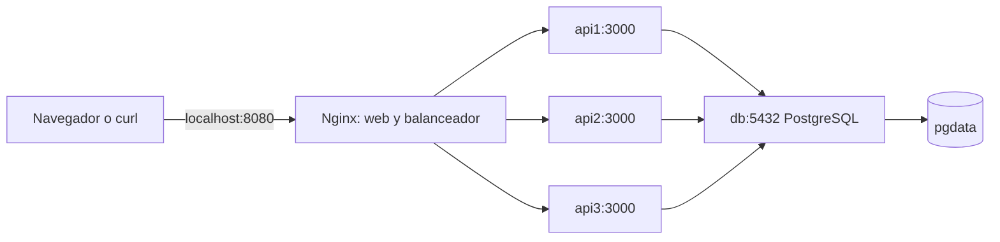

# Informe de la práctica: CampusTareas con Docker

## Alcance y estado

Se han preparado todos los archivos de despliegue y los cinco retos opcionales. Por indicación del usuario, el cliente Android del paso 6 se sustituye por un cliente web en `web/`: crea, lista, filtra, busca y completa tareas a través del balanceador. Esta sustitución requiere que el docente acepte el cambio de plataforma para su rúbrica de Android.

La implementación y la validación estática están realizadas. **La ejecución de contenedores, las evidencias de persistencia y balanceo, el escaneo de vulnerabilidades y la publicación en GHCR siguen pendientes**: el entorno del agente no puede conectarse al motor Docker. No se presentan como resultados observados las predicciones siguientes. Consultar `VALIDACION.md` y `evidencias/README.md`.

## Arquitectura



Cinco contenedores y un volumen, sin publicar puertos de la base ni de las réplicas. Compose crea la red y su DNS; Nginx sirve los tres archivos del cliente y reenvía las rutas de API. Los archivos web se montan en lectura. Las credenciales residen en `.env`, ignorado por Git, y `.env.example` documenta las variables sin revelar la clave local.

## Evidencias por paso

| Paso | Implementación | Evidencia que genera la ejecución |
|---|---|---|
| 1 | Repositorio Git inicializado; Docker y Compose detectados | `01-manual.log`: versiones |
| 2 | `api/Dockerfile`, `.dockerignore` | `01-manual.log`: imágenes y capas |
| 3 | `scripts/01-Manual.ps1` | Red, conexión por nombre, versión y fallo sin DATABASE_URL |
| 4 | `compose.una.yaml` | `02-persistencia.log`: lectura tras down y down -v |
| 5 | `compose.yaml`, `nginx/nginx.conf` | `03-round-robin.log`: 3, 2 y 1 réplicas, HTTP 200, datos compartidos |
| 6 adaptado | `web/`, `scripts/08-Web.ps1` | Tarea creada en web, captura y continuidad con api2 sola |
| 7 | `scripts/09-Cierre.ps1` | Pila detenida, datos e imágenes conservados |

## Respuestas de análisis

### 1. Orden de COPY y caché

Las dependencias cambian menos que el código. Copiar primero los manifiestos permite reutilizar la capa de `npm ci --omit=dev` cuando solo cambia `src/server.js`. Al cambiar el código, se invalida `COPY src` y lo que dependa de él, sin reinstalar las dependencias. `04-Analisis.ps1` construye una base y otra copia con un comentario añadido, usando `--progress=plain`; no altera el código original. La salida debe mostrar `CACHED` en las instrucciones reutilizadas. Registrar las líneas reales de `evidencias/04-analisis.log`; todavía no se han observado.

### 2. Imagen Alpine frente a node:24

`api/Dockerfile.pesada` mantiene la primera etapa Alpine y cambia únicamente la etapa final a `node:24`, como pide la guía. Comandos:

```powershell
docker build -t campus-api:1.0.0 ./api
docker build -f api/Dockerfile.pesada -t campus-api:pesada ./api
docker images campus-api
docker image inspect campus-api:1.0.0 campus-api:pesada --format '{{.RepoTags}} bytes={{.Size}}'
```

La base completa suele tener más herramientas y paquetes, por lo que necesita más almacenamiento y transferencia si esas capas no están ya descargadas. También contiene más componentes que mantener y posibles vulnerabilidades. Un menor tamaño no garantiza por sí solo mayor seguridad: hay que escanear ambas bases y mantenerlas actualizadas. Alpine usa musl y la base Debian glibc; este proyecto usa dependencias JavaScript, pero con módulos nativos habría que reconstruirlos para la base de destino. Los tamaños medidos quedan pendientes de ejecución; no se adopta como medición el tamaño orientativo del PDF.

### 3. db:5432 frente a localhost

Cada contenedor tiene su propio espacio de red. Dentro de la API, `localhost` identifica a la propia API. `db` es el nombre del servicio de PostgreSQL, resuelto por el DNS de Docker en la red compartida. `5432` es su puerto interno; no necesita publicarse en el host.

### 4. Persistencia

`docker compose down` elimina contenedores y red, conservando el volumen nombrado. PostgreSQL escribe en `/var/lib/postgresql/data`, montado desde `pgdata`, y vuelve a leerlo al arrancar. `down -v` elimina además ese volumen y, al crearse uno nuevo, la tabla queda vacía. En Docker Desktop el volumen se almacena en el disco administrado del entorno Linux de Docker, no en el sistema de archivos efímero de la API. `02-Persistencia.ps1` realiza ambas comprobaciones exclusivamente en el proyecto de prueba `campus-una`. Los datos de `campustareas` quedan separados.

### 5. Caída de api2

El resultado real se comprobará en `03-round-robin.log`. La configuración está diseñada para reintentar peticiones de lectura en otra réplica mediante `proxy_next_upstream error timeout http_502 http_503`. `max_fails=2 fail_timeout=10s` excluye temporalmente una réplica que acumula fallos y `proxy_connect_timeout 2s` acota la espera de conexión. Algunas peticiones pueden tardar más durante la detección. No se debe prometer ausencia absoluta de errores: si fallan todas las réplicas o la base, no habrá servicio. Nginx tampoco reintenta de forma general peticiones no idempotentes ya enviadas; reintentar ciegamente un POST podría duplicar tareas.

### 6. Tareas en un arreglo en memoria

Cada réplica tendría un arreglo distinto. Una tarea creada en api1 podría no aparecer al consultar api2 y se perdería al reiniciar el proceso que la creó. Compartir PostgreSQL hace que todas las réplicas lean el mismo estado persistente. No se necesita afinidad de sesión para consultar las tareas.

### 7. Contraseña fuera del repositorio

Una clave literal en Compose puede filtrarse por el historial Git, copias o revisión del repositorio. Aquí se usa `${POSTGRES_PASSWORD:?...}` y un `.env` local ignorado. `.env.example` contiene solo una indicación de reemplazo. La clave generada tiene caracteres seguros para formar la URL de conexión. `.env` no es cifrado: hay que controlar su acceso, evitar compartir `docker compose config` sin redacción y recordar que las variables del contenedor pueden ser inspeccionadas por quien controla Docker. En producción conviene usar un gestor de secretos. Cambiar `.env` no cambia la contraseña de un volumen PostgreSQL ya inicializado: debe cambiarse también en la base; no borrar datos para rotarla.

### 8. USER node

Reduce los privilegios del proceso dentro del contenedor. Si se compromete la API, el atacante no obtiene automáticamente el usuario root del contenedor. `--chown=node:node` permite acceder a los archivos necesarios y el puerto 3000 no requiere privilegios. No sustituye el aislamiento, las actualizaciones ni los controles del host. `04-Analisis.ps1` ejecuta `id` para registrar el usuario efectivo.

## Retos opcionales

1. **Secretos**: implementado `.env` local con clave aleatoria y `.env.example`; verificar con `git check-ignore .env`. Nunca agregar `.env` al repositorio.
2. **least_conn**: implementados `nginx/least-conn.conf` y `compose.least-conn.yaml`. Ejecutar `03-Balanceo.ps1 -LeastConn`. Round robin reparte por turnos; least_conn elige la réplica con menos conexiones activas. En solicitudes secuenciales rápidas pueden parecer iguales y no hay garantía de observar un reparto distinto. Para mostrar su ventaja se necesita tráfico concurrente con duraciones variables; `/v1/trabajo-pesado` permite explorar carga, aunque su duración es similar entre peticiones. La prueba exige disponibilidad y visibilidad de tres réplicas, no una secuencia estricta.
3. **Vulnerabilidades**: script `05-Escanear.ps1` ejecuta `docker scout cves campus-api:1.0.0`. Pendiente obtener resultados reales. Para completar: anotar una CVE, paquete, versión instalada, severidad, versión corregida y corregir actualizando la base o dependencia correspondiente, reconstruyendo y volviendo a escanear. No se inventa un identificador. Si no hay vulnerabilidades, adjuntar el resultado real y explicar que corresponde a esa imagen y esa fecha. Scout puede requerir autenticación a Docker Hub.
4. **GHCR**: script `06-Publicar.ps1` preparado para `aleduss07`, identidad inferida de Git (`Aleduss07`). Ejecuta login, tag y push a `ghcr.io/aleduss07/campus-api:1.0.0`; falta verificar autenticación y publicación real. No envíes el token al chat. Un PAT clásico necesita `write:packages` y las autorizaciones de organización que correspondan. Revisar la visibilidad del paquete en GitHub si el docente debe descargarlo.
5. **1.1.0**: script `07-Version.ps1` construye con `--build-arg APP_VERSION=1.1.0`, despliega, consulta 12 veces `/v1/info`, comprueba la versión y actualiza `.env` solo después de verificar. Se conservan ambas imágenes para Kubernetes.

## Entrega final pendiente de evidencias

Después de ejecutar los scripts, incorporar los logs revisados y una captura web, sustituir los estados pendientes de este informe por resultados observados, analizar una CVE real si existe y agregar el enlace del repositorio y el digest del push. La publicación de la imagen y la publicación de un repositorio son acciones distintas; todavía no existe un remoto configurado.
